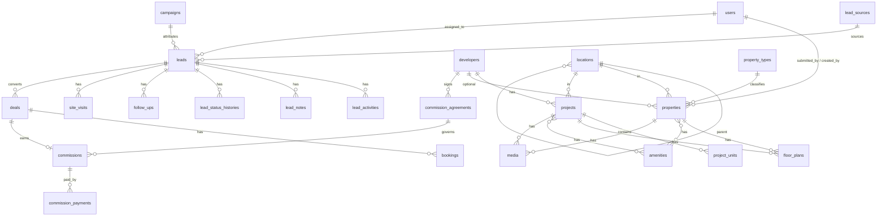

# 10 — Database Architecture

PostgreSQL 16. This document defines conventions, the **MVP schema** (tables created in phases 1–5), the **extension schema** (phases 6–8) and the future schema. Do not create a table before its phase.

## 1. Conventions
- Table names plural snake_case; pivots alphabetical singular (`amenity_property`) unless extra columns (then a noun, e.g. `property_amenities`). Columns snake_case.
- PK: `id` bigint identity. Public identifiers: `slug` (SEO) and, where exposure of sequence matters (leads, deals), `uuid` column (`ulid`) used in URLs/exports — never expose sequential lead IDs publicly.
- Timestamps: `created_at`, `updated_at` (timestampTz). Soft deletes (`deleted_at`) on: properties, projects, developers, leads, deals, users, pages, blog_posts. Not on: pivots, history/log tables, payments (cancel via status; immutable ledger).
- Money: `decimal(14,2)` in BDT (`price`, `amount`), column suffix none; `currency` char(3) default `BDT` on price-bearing tables for future-proofing. Rates: `decimal(7,4)`. Never float. Area: `decimal(10,2)` sqft (`size_sqft`); land may add `land_area_katha` later.
- Status columns: `string` + PHP backed enum + DB `CHECK` constraint (via raw statement) for critical state machines (lead, visit, commission). Use string over native PG enum to keep migrations easy.
- Foreign keys always constrained; `ON DELETE`: `restrict` for business records (developer→project), `cascade` for owned children (property→images), `set null` for optional references (lead.assigned_to). Indexed FK columns.
- Booleans `is_*`; datetimes `*_at`; dates `*_on`.
- JSON (`jsonb`) only for flexible, non-queried data (e.g. saved-search filters, audit old/new values, settings).
- Text search: generated `tsvector` columns + GIN; `pg_trgm` extension for fuzzy names (enabled by migration).
- Phone stored normalised E.164 (`phone`) plus original display optional. Emails lowercased.
- Migration strategy: one concern per file, reversible `down()`, timestamped; never edit merged migrations; seed reference data (roles, types, lead sources) in seeders (idempotent `upsert`), demo data in `DemoSeeder` guarded to non-production and clearly labelled.

## 2. ERD (core)

## 3. MVP schema (Phases 1–5)
### Phase 1 — Foundation
| Table | Key fields / notes |
|---|---|
| `users` | name, email (unique, citext/lower), phone (nullable, unique where not null), password, email_verified_at, status (`active`/`suspended`), last_login_at, locale, soft deletes |
| Spatie: `roles`, `permissions`, `model_has_roles`, `model_has_permissions`, `role_has_permissions` | as package |
| `settings` | `group`, `key` (unique pair), `value` jsonb, `is_public` |
| `audit_logs` | user_id null, event, auditable_type/id, old_values jsonb, new_values jsonb, ip, user_agent, created_at; index (auditable_type, auditable_id), (user_id), (created_at). Append-only. |
| `jobs`, `failed_jobs`, `job_batches`, `cache`, `cache_locks`, `sessions`, `notifications`, `password_reset_tokens` | Laravel defaults |
### Phase 2 — Supply
| Table | Key fields / notes |
|---|---|
| `locations` | parent_id, type (`country,division,district,city,area,sector,road`), name, name_bn, slug, path (materialised, e.g. `dhaka/gulshan`, unique), latitude, longitude, description, is_active, is_featured, seo_*; index (parent_id), (type), unique(path); `pg_trgm` index on name |
| `property_types` | name, slug, group (`residential`,`land`,`commercial`,`industrial`), sort_order, is_active (seeded: apartment, flat, duplex, penthouse, house, villa, land/plot, commercial, office, shop, industrial, warehouse) |
| `amenities` | name, slug, icon, group, is_active |
| `developers` | name, slug, logo (media), about, website, email, phone, address, established_year (nullable), status (`draft,active,inactive`), is_verified, verified_at, verified_by, is_featured, seo_*; soft deletes |
| `projects` | developer_id FK, location_id FK, name, slug (unique), summary, description, status (`upcoming,ongoing,ready,completed`), construction_progress (0–100 nullable), total_floors, total_units, handover_on, address, lat/lng, price_from/price_to (nullable, decimal), payment_plan (text), video_url, brochure (media private/public flag), publish_status (`draft,published,archived`), published_at, is_verified, verified_at/by, is_featured, featured_until, available_units_verified bool, seo_*; soft deletes; indexes (developer_id),(location_id),(publish_status,status),(is_featured) |
| `project_unit_types` | project_id, name (e.g. "3-bed A"), bedrooms, bathrooms, size_sqft_min/max, price_from, price_to |
| `project_units` | project_id, unit_type_id nullable, unit_no, floor, facing, size_sqft, price, status (`available,booked,sold,hold`), verified_at; unique(project_id, unit_no) |
| `properties` | public_code (e.g. `PC-1042`, unique), slug (unique), title, description, purpose (`sale,rent`), property_type_id, location_id, project_id null, developer_id null, project_unit_id null, address_line, latitude, longitude, price decimal(14,2), price_negotiable bool, rent_period null, size_sqft, bedrooms, bathrooms, balconies, floor_no, total_floors, facing, parking_spaces, furnishing (`unfurnished,semi,furnished`), property_status (`ready,under_construction,upcoming`), year_built, handover_on, payment_plan, nearby (jsonb list), video_url, publish_status (`draft,pending_review,published,rejected,archived,sold,rented`), published_at, price_updated_at, expires_at, is_featured, featured_until, is_verified, verified_at/by, submitted_by (user) null, created_by, view_count (denormalised, optional), search_vector tsvector, seo_*; soft deletes. Indexes: (publish_status, purpose, property_type_id, location_id), (price), (size_sqft), (bedrooms), (is_featured, featured_until), (published_at), GIN(search_vector), (developer_id), (project_id) |
| `amenity_property`, `amenity_project` | composite PKs |
| `floor_plans` | floorplanable (morph: property/project/unit type), title, caption, media; sort_order |
| `media` | Spatie Media Library table (model_type/id, collection_name, disk, conversions, custom_properties: alt, caption, `is_private`); `order_column` |
| `verifications` | verifiable morph (property/project/developer), verified_by, verified_on, method/notes (text), evidence in private media, status (`verified,revoked`), revoked_at/reason. Source of truth for "Verified" badges (denormalised flags on parent updated by service). |
| `slug_histories` | sluggable morph, slug, created_at → 301s |
### Phase 3 — Public/CMS
| Table | Notes |
|---|---|
| `leads` (minimal, extended in 5) | uuid, name, phone, email null, message, source_id, request_type (`property_inquiry,project_inquiry,developer_inquiry,contact,site_visit,sell,rent,valuation,assistance`), property_id null, project_id null, developer_id null, consent_given_at, consent_text_version, utm_source/medium/campaign/term/content, landing_url, referrer, ip_hash, user_agent (truncated), status default `new`; honeypot-failed submissions are not stored. |
| `pages` | slug, title, body (sanitised HTML/markdown), template, is_published, seo_*, soft deletes |
| `faqs` | question, answer, category, sort_order, is_published |
| `banners` | title, image media, link, placement, starts_at, ends_at, is_active |
| `testimonials` | name, role, quote, source_note, consent_on (must be real), is_published |
| `blog_categories`, `blog_posts` | slug, title, excerpt, body, cover media, category, author_id, status, published_at, seo_*; soft deletes |
| `navigation_items` | optional (P1); menu, label, url/route, parent_id, sort_order |
### Phase 4 — Buyer/Seller
| Table | Notes |
|---|---|
| `favorites` | user_id, favoritable morph (property/project); unique(user_id, favoritable_type, favoritable_id) |
| `saved_searches` | user_id, name, filters jsonb, last_run_at, alerts_enabled (false in MVP) |
| `recently_viewed` | user_id, viewable morph, viewed_at; capped per user (prune); guests use session |
| `newsletter_subscribers` | email unique, consent_at, token, unsubscribed_at |
| Property submissions reuse `properties` (`publish_status=pending_review`, `submitted_by`) plus `owner_name/owner_phone/owner_email` (private columns, never rendered publicly) and `property_reports` (listing reports: property_id, reason, details, reporter contact optional, status) — ADR-0009. |
### Phase 5 — CRM
| Table | Notes |
|---|---|
| `lead_sources` | name, slug, type (`website,whatsapp,phone,facebook,instagram,google,referral,walk_in,offline,other`), is_active |
| `leads` (extended) | + budget_min/max, preferred_location_id, property_type_id, purpose, priority (`low,normal,high,urgent`), status (`new,contacted,qualified,interested,site_visit,negotiation,converted,lost,not_interested,invalid,duplicate`), assigned_to, assigned_at, next_follow_up_at, last_contacted_at, closed_reason, duplicate_of_id, campaign_id (Phase 7), anonymised_at; indexes: (status), (assigned_to, status), (next_follow_up_at), (phone), (created_at), (source_id) |
| `lead_notes` | lead_id, user_id, body, is_pinned |
| `lead_activities` | lead_id, user_id null, type (`call,whatsapp,email,meeting,site_visit,note,status_change,assignment,system`), summary, meta jsonb, occurred_at |
| `lead_status_histories` | lead_id, from_status, to_status, changed_by, reason, changed_at |
| `follow_ups` | lead_id, assigned_to, due_at, type, notes, status (`pending,done,cancelled`), completed_at, reminder_sent_at; index (assigned_to,status,due_at) |
| `site_visits` | lead_id, property_id null, project_id null, user_id (buyer, nullable), preferred_date, preferred_window, scheduled_at, assigned_to, developer_contact_name/phone, meeting_point, status (`requested,confirmed,rescheduled,completed,cancelled,no_show`), feedback, outcome, reminder_sent_at; check: property or project required |
## 4. Extension schema
### Phase 6 — Sales
| Table | Notes |
|---|---|
| `deals` | uuid, lead_id, buyer_name/phone (snapshot), property_id null, project_id null, project_unit_id null, developer_id, agent_id, listed_price, negotiated_price, sale_price, booking_amount, status (`negotiation,booked,sold,cancelled,lost`), deal_on, closed_on, notes; soft deletes |
| `bookings` | deal_id, amount, booked_on, payment_method note, reference, status (`pending,confirmed,refunded,cancelled`) |
| `commission_agreements` | developer_id/owner null, title, type (`percentage,fixed`), rate decimal(7,4) null, fixed_amount null, basis (`sale_price,negotiated_price,booking_amount`), trigger (`booking,registration,full_payment,handover`), valid_from_on, valid_to_on, document (private media), terms text, status (`draft,active,expired,terminated`); applies to developer/project/property scope |
| `commissions` | deal_id, agreement_id, basis_amount, rate_snapshot, calculated_amount, adjustment, payable_amount, status (`pending,approved,due,partial_paid,paid,cancelled`), approved_by/at, due_on; calculation snapshots agreement terms so later edits don't rewrite history |
| `commission_payments` | commission_id, amount, paid_on, method, reference, received_by, notes; immutable (corrections via reversing entry); sum ≤ payable (enforced in service + check) |
### Phase 7 — Marketing
`campaigns` (name, slug, channel, utm defaults, budget, starts_on/ends_on, status), `campaign_costs` (campaign_id, amount, incurred_on, note), `campaign_leads` (only if many-to-many attribution needed; MVP uses `leads.campaign_id`), `landing_pages` (slug, campaign_id, template, content jsonb, status), `tracking_events` (event, subject morph, session_id hashed, utm snapshot, occurred_at; pruned after N days).
### Phase 8 — Partners
`agents` (user_id, employee_code, commission_split?, status), `developer_user` (developer_id, user_id, role), `owners` profile (optional), `partnership_records` (partner morph, agreement ref, started_on, status, document private).
### Cross-cutting later
`notifications` (already), `webhook_logs`, `exports` (record of data exports).

## 5. Key constraints & indexes summary
- Unique: `users.email`, `properties.slug`, `properties.public_code`, `projects.slug`, `developers.slug`, `locations.path`, `project_units(project_id, unit_no)`, `favorites(user,favoritable)`.
- Check: `properties.price >= 0`, `size_sqft > 0`, `leads` consent required when source=`website` (enforced in app + `consent_given_at IS NOT NULL` check for web sources), `commission_payments.amount > 0`, `site_visits` property/project presence.
- Partial indexes: `properties(published_at) WHERE publish_status='published' AND deleted_at IS NULL`; `leads(next_follow_up_at) WHERE status NOT IN (terminal)`.
- Featured: `is_featured AND (featured_until IS NULL OR featured_until > now())` via scope; daily job clears expired flags.

## 6. Audit, retention, privacy
- Audited models: properties, projects, developers, users/roles, leads (assignment, status, export, contact reveal), deals, commissions, payments, settings, verification.
- Retention (defaults, confirm legally): invalid/duplicate leads purged or anonymised after 12 months; lost leads anonymised after 24 months; tracking events 90–180 days; audit logs 24 months; failed jobs 7 days; guest sessions per Laravel config; newsletter unsubscribed hashed emails kept for suppression.
- Anonymisation: lead name→"Anonymised", phone/email nulled/hashed for suppression, free-text cleared, `anonymised_at` set; aggregates preserved.
- Soft deleted records excluded by default; hard purge job after retention.

## 7. Seeders
Reference data: roles/permissions, property types, amenities (common list), lead sources, Bangladesh divisions/districts (from a verified public dataset — source cited in seeder), default settings keys (values empty). **Demo data** (`DemoSeeder`): clearly marked "[DEMO]" titles, `.example` contact values, blocked outside local/staging via guard + test.

## 8. Consistency notes
- Contact submissions are leads (no separate `contact_inquiries` table) — ADR-0007.
- `owners`/`buyers`/`agents` are **roles on `users`**, not separate tables in MVP; profile extras live in `user_profiles` only if needed (Phase 4/8).
- "Verified" always derives from `verifications` rows.
